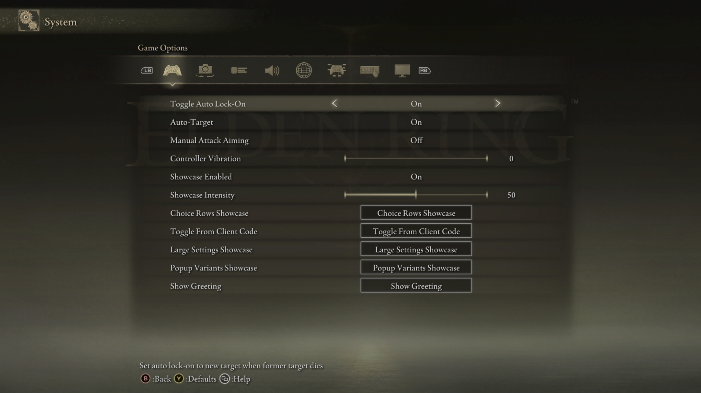

# Settings controls

Every settings row belongs to a `Page` during provider registration.
ERNativeUI copies its visible text, owns the canonical UI value for
value-bearing controls after commit, and gives client mods opaque row handles
rather than game pointers. Buttons and Submenus intentionally own no value.

This section documents every settings control in the current C++17 wrapper.
A [Submenu](submenu.md) is included because the player interacts with its
action row like another control, although it creates a child `Page` instead of
owning a value.

## Start with one isolated control

Every control page begins with the smallest useful call for that control. The
examples receive an `erui::Page` explicitly so it is always clear where the row
is added; the surrounding connection and menu setup is explained once in the
[first-mod guide](../../getting-started/first-mod.md).

The screenshots come from the buildable
[Showcase Screenshot Helper](../../../examples/showcase_screenshot_helper/README.md).
It places one documented control inside an otherwise empty Submenu so built-in
Elden Ring rows do not obscure the result. Its INI selects the control at
startup:

```ini
[showcase]
mode=toggle
```

Restart the game, then open **System -> Game Options -> Toggle Showcase**.
Change `mode` to the value named by another control page to reproduce that
page instead. Each guide later adds any state, callbacks, and error handling
that a real mod commonly needs.



*After learning one isolated row at a time, controls can be combined on a real
page like this larger integration showcase.*

## Choose a control

| Order | Control | What the player does | Stored value | API |
|---:|---|---|---|---|
| 1 | [Button](button.md) | Confirms one action | None | 1.0 |
| 2 | [Submenu](submenu.md) | Opens a provider-owned child page | None; returns a `Submenu` child-page builder/reference | 1.0 |
| 3 | [Toggle](toggle.md) | Chooses off or on | `0` or `1` | 1.0 |
| 4 | [Slider](slider.md) | Adjusts a bounded integer | `std::uint8_t` | 1.0 |
| 5 | [Numeric Slider](numeric-slider.md) | Adjusts a signed or decimal sequence | Exact base-10 value and logical index | 1.2 |
| 6 | [Custom Slider](custom-slider.md) | Slides through arbitrary display labels | Zero-based index | 1.2 |
| 7 | [Inline Choice](inline-choice.md) | Cycles labels with left/right | Zero-based index | 1.0 |
| 8 | [Popup Choice](popup-choice.md) | Selects from a native list | Zero-based index | 1.0 |
| 9 | [TextInput](text-input.md) | Opens native text editing | UTF-16 string | 1.1 |
| 10 | [ColorPicker](color-picker.md) | Opens the native RGB editor | Three byte channels | 1.1 |

Use an inline choice for a short list that is comfortable to cycle through.
Use a popup choice when seeing all labels before confirming is more useful.
Use a button when the row performs work but does not itself own a setting.

## Shared control concepts

- [Capabilities](../capabilities.md) explains the **Capability requirements**
  section found on every control page and how to check host support.
- [Enabled controls](options/enabled.md) explains the registration-time option,
  why some construction-disabled rows are omitted, and how API 1.4 runtime
  availability differs from that initial state.

## Rules shared by every control

- `label` is required and must not be empty; `help` may be empty.
- Visible strings are UTF-16 `std::wstring_view` values. The host copies them
  synchronously during the builder call. An ordinary visible field accepts at
  most 4,096 valid UTF-16 code units; embedded NUL and invalid surrogate pairs
  are rejected.
- Builder calls happen only inside `Connection::register_menu`. A failed call
  poisons and aborts the private draft instead of publishing a partial menu.
- Callbacks and externally supplied `user_data` must remain valid until process
  exit after a successful commit. Never hot-unload a committed client DLL.
- Every callback must be `noexcept`. Catch allocation, persistence, and other
  failures inside the callback.
- Ordinary `Page::add_*` calls return a typed row such as `ToggleRow`,
  `SliderRow`, or `TextInputRow`. Retain it only when later runtime getters or
  setters need it. Each typed row exposes `handle()` and converts implicitly
  to the API 1.3 `RowHandle`, preserving existing raw-handle source patterns.
  `add_submenu` instead returns a `Submenu`: it is a child `Page` builder during
  registration and a stable presentation-edit reference after commit.
- Declare logical rows without assuming how many fit on screen. ERNativeUI
  paginates from the capacity of the live native page.

Button callbacks run synchronously on Elden Ring's UI thread. Value-change,
TextInput, and ColorPicker callbacks run on the ERNativeUI worker. Keep all of
them short and synchronize state shared with other threads.

## Reading and changing committed values

Keep the typed rows outside the builder when code must interact with them
later. They become active after their surrounding registration succeeds:

```cpp
std::uint8_t number{};
const ERUI_Result value_read = slider_row.get_value(number);
const ERUI_Result value_write = slider_row.set_value(75);

std::wstring text;
const ERUI_Result text_read = text_row.get_text(text);
const ERUI_Result text_write = text_row.set_text(L"Melina");

erui::Color color{};
const ERUI_Result color_read = color_row.get_color(color);
const ERUI_Result color_write =
    color_row.set_color({90, 120, 180});

double decimal{};
const ERUI_Result numeric_read = numeric_row.get_value(decimal);
const ERUI_Result numeric_write = numeric_row.set_value(-0.5);

std::uint32_t custom_index{};
const ERUI_Result custom_read = custom_row.get_index(custom_index);
const ERUI_Result custom_write = custom_row.set_index(4);
```

Check each `ERUI_Result` against `ERUI_OK` before using a read value or
assuming that a write was accepted. The distinct names above make every
operation visible; real code may return early after the first error.

`ToggleRow`, `SliderRow`, and `NumericSliderRow` use `get_value` and
`set_value`. Choice and Custom Slider rows use `get_index` and `set_index`.
TextInput and ColorPicker provide `get_text`/`set_text` and
`get_color`/`set_color`. Programmatic writes are silent: they update canonical
state and presentation but do not pretend the player made a change or invoke
a change callback.

Existing API 1.3 source may still assign any typed row to `erui::RowHandle`
and use the matching `Registration` getter or setter. The conversion is
implicit; no host ABI or C API operation changed for this typed C++
foundation. Destroying the C++ `Registration` value only discards that
client-side access handle. It does not unregister the committed provider, and
retained typed rows continue to own the context needed by their operations.

## Runtime presentation

Most controls use stock native widgets. By default, ERNativeUI completes
supported settings movies at runtime to provide the matching left label on
affected action rows and richer TextInput and ColorPicker appearances. No
loose GFX asset is normally required. Players can disable this host-wide
patching while retaining functional control fallbacks. Structurally compatible
movies from other mods remain supported; see
[Runtime GFX completion and presentation](../presentation-and-gfx.md).

For the complete ownership, limits, and error contract, see
[Lifecycle, errors, and limits](../../reference/lifecycle-errors-and-limits.md).

Next: [Button](button.md)
