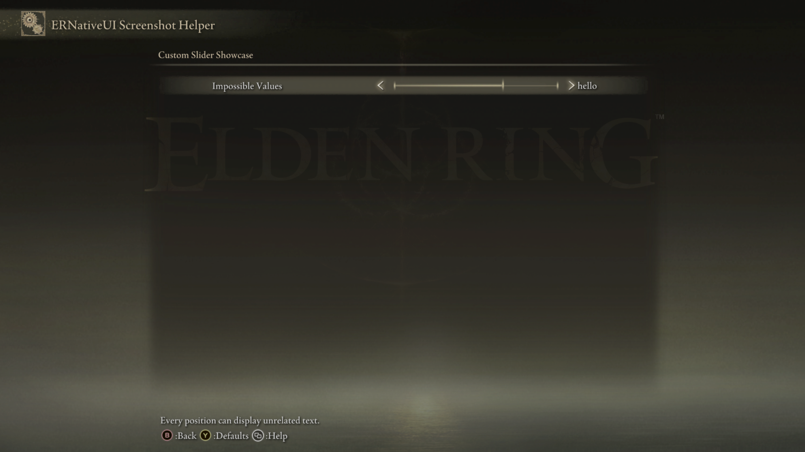
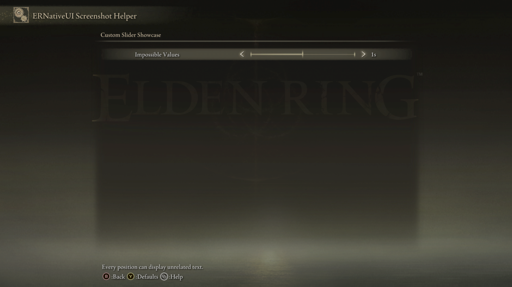

# Custom Slider

<table>
  <tr>
    <td align="center" valign="middle">
      <a href="../capabilities.md#what-a-capability-is"></a>
    </td>
    <td valign="middle">
      <a href="../capabilities.md#custom-slider"><code>custom_slider</code></a>
    </td>
  </tr>
</table>

A Custom Slider maps each native slider position to any text chosen by the
mod. The values do not need to be numeric, ordered, or related:

```text
0 -> -7
1 -> 3
2 -> 7.8
3 -> 1s
4 -> hello
5 -> 18
6 -> x1.3
```

Use it when the native slider presentation is useful but an arithmetic
[Numeric Slider](numeric-slider.md) cannot describe the values. Use an
[Inline Choice](inline-choice.md) when the presentation should be a compact
left/right label selector without a slider bar.


*The bar still behaves like a native slider, while the visible value comes
from the client-provided label for the selected index.*

## Minimal example

```cpp
#include <ernativeui/ERNativeUI.hpp>

#include <array>
#include <string>
#include <string_view>

erui::CustomSliderRow add_impossible_values(erui::Page page) noexcept
{
    static constexpr std::array<std::wstring_view, 7> values{
        L"-7", L"3", L"7.8", L"1s", L"hello", L"18", L"x1.3"};

    erui::CustomSliderOptions options{};
    options.value_count = static_cast<std::uint32_t>(values.size());
    options.initial_index = 4; // Displays "hello".
    options.format_value =
        [](std::uint32_t index, std::uint32_t) -> std::wstring {
            return index < values.size()
                ? std::wstring(values[index])
                : std::wstring{};
        };

    return page.add_custom_slider(
        L"Impossible Values",
        L"Every position can display unrelated text.",
        options);
}
```

`format_value` is called synchronously once for every index while
`add_custom_slider` runs. ERNativeUI copies every returned string. The
formatter is then discarded and is never called from Elden Ring's UI thread.

That formatter defines the registration-time table. API 1.4 can later replace
the complete same-cardinality table through
`slider.edit().values(...).commit()` while preserving the selected index. See
[Replace slider display labels at runtime](../row-updates/slider-labels.md).



*The screenshot helper uses index `4`, whose unrelated display label is
`hello`, as the initial value.*

## API at a glance

```cpp
erui::CustomSliderRow erui::Page::add_custom_slider(
    std::wstring_view label,
    std::wstring_view help_message,
    const erui::CustomSliderOptions& options) noexcept;
```

The wrapper also provides stateless and stateful callback overloads:

```cpp
struct ModSettings {
    std::uint32_t selected_style{1};
};

void style_changed(
    ModSettings& settings,
    const erui::CustomSliderChange& change) noexcept
{
    settings.selected_style = change.index;
}

erui::CustomSliderRow add_style_slider(
    erui::Page page,
    ModSettings& settings) noexcept
{
    static constexpr std::array<std::wstring_view, 3> names{
        L"Calm", L"Wild", L"Unthinkable"};

    erui::CustomSliderOptions options{};
    options.value_count = static_cast<std::uint32_t>(names.size());
    options.initial_index = settings.selected_style;
    options.format_value =
        [](std::uint32_t index, std::uint32_t) -> std::wstring {
            return index < names.size()
                ? std::wstring(names[index])
                : std::wstring{};
        };

    return page.add_custom_slider<&style_changed>(
        L"Style",
        L"Choose the mod's style.",
        options,
        settings);
}
```

The change callback runs on ERNativeUI's worker and receives only the selected
logical index and total position count. The mod decides what that index means.



*One Left press moves from index `4` to index `3`, demonstrating that a label
may be a unit-formatted value rather than a plain number.*

## Use mod settings while generating labels

Because formatting finishes inside the builder call, the callable may capture
client state safely:

```cpp
options.format_value =
    [&settings](std::uint32_t index, std::uint32_t count) {
        return settings.localized_slider_label(index, count);
    };
```

The referenced object only needs to remain valid until `add_custom_slider`
returns for formatting purposes. If the same object is also passed to a
change callback, that callback state must instead live until process exit
after a successful commit.

## `CustomSliderOptions`

| Member | Default | Meaning |
|---|---:|---|
| `value_count` | `0` | Number of logical positions; must be from 2 through 256 |
| `initial_index` | `0` | Zero-based starting position; must be lower than `value_count` |
| [`enabled`](options/enabled.md) | `true` | `false` leaves a disabled row visible and still consumes a page slot |
| `format_value` | Empty | Required callable returning the display string for one index |

Each generated value must be non-empty, valid UTF-16, and at most 64 UTF-16
code units. Duplicate strings are allowed because identity comes from the
index, not the text. If formatting throws or returns an invalid value,
registration fails cleanly rather than publishing a partial menu.

## Understand the change event

`CustomSliderChange` contains:

| Member | Meaning |
|---|---|
| `provider` | Provider that owns the row |
| `row` | This Custom Slider's handle |
| `index` | Selected zero-based logical position |
| `value_count` | Total number of positions |

`index` is deliberately the only value. ERNativeUI does not retain the
client's original objects or attempt to parse the generated label.

## Read or change the committed index

```cpp
std::uint32_t index{};
const ERUI_Result read_result = slider.get_index(index);

const ERUI_Result write_result = slider.set_index(4);
```

An index must be lower than the row's `value_count`; an invalid index is
rejected rather than clamped. A successful programmatic write updates the
native row without invoking the player-change callback.

`CustomSliderRow` becomes active after registration succeeds. It exposes
`handle()` and converts implicitly to `erui::RowHandle`, so API 1.3 source may
continue using `Registration::get_custom_slider_index` and
`Registration::set_custom_slider_index` with a retained raw handle.

## Capability requirements

| Property | Value |
|---|---|
| First public API | 1.2 |
| Required capability | `erui::Capability::custom_slider` / `ERUI_CAP_CUSTOM_SLIDER` |
| GFX presentation | Uses the stock native slider widget |
| Positions | 2 through 256 |
| Maximum text per position | 64 valid UTF-16 code units |

See [the `custom_slider` capability](../capabilities.md#custom-slider) before using a
feature that may be absent from the connected host.

## Common mistakes

- Returning a view or pointer instead of the required owning `std::wstring`.
  The wrapper asks the formatter to produce one complete value at a time.
- Performing game calls in `format_value`. It is a startup builder operation;
  prepare or copy the data before registration instead.
- Expecting the callback to contain a parsed number or original object. It
  reports the selected index only.
- Expecting an out-of-range runtime write to clamp to the last position.
- Choosing Custom Slider for a short ordinary list when Inline Choice
  communicates the setting more clearly.

[Controls index](README.md) |
[Reverse-engineering reference](../../research/case-studies/formatted-sliders.md) |
Previous: [Numeric Slider](numeric-slider.md) |
Next: [Inline Choice](inline-choice.md)
