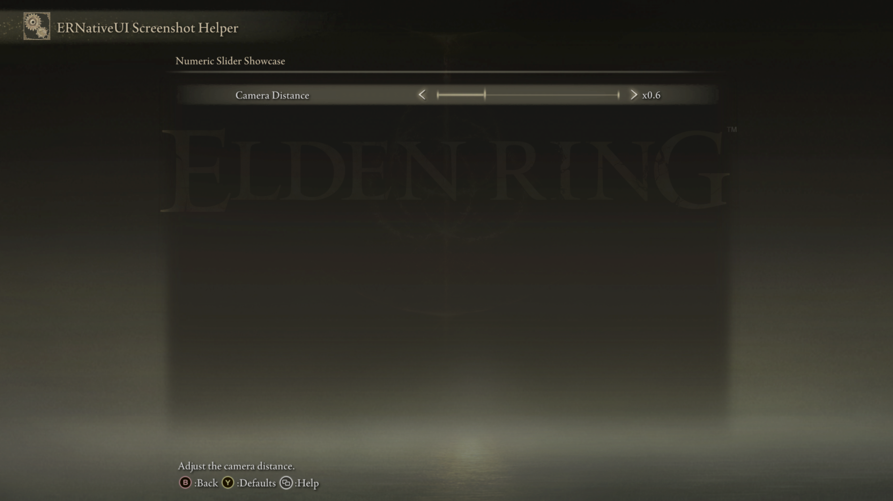

# Numeric Slider

<table>
  <tr>
    <td align="center" valign="middle">
      <a href="../capabilities.md#what-a-capability-is"></a>
    </td>
    <td valign="middle">
      <a href="../capabilities.md#numeric-slider"><code>numeric_slider</code></a>
    </td>
  </tr>
</table>

A Numeric Slider uses Elden Ring's native slider row for signed or decimal
settings. It can also place fixed text before or after the number, so values
such as `x0.6`, `-0.5`, and `3.0s` remain native left/right controls.

Use a [Slider](slider.md) instead when the setting is naturally one unsigned
byte. Use a [Custom Slider](custom-slider.md) when each position needs an
unrelated label rather than an arithmetic sequence.


*The native slider bar can present signed or decimal text with an optional
prefix or suffix.*

## Minimal example

This slider represents camera distance from `0.1` through `2.0`, changes by
`0.1`, starts at `0.6`, and displays the value as `x0.6`:

```cpp
#include <ernativeui/ERNativeUI.hpp>

erui::NumericSliderRow add_camera_distance(erui::Page page) noexcept
{
    erui::NumericSliderOptions options{};
    options.minimum = 0.1;
    options.maximum = 2.0;
    options.step = 0.1;
    options.initial_value = 0.6;
    options.decimal_places = 1;
    options.prefix = L"x";

    return page.add_slider(
        L"Camera Distance",
        L"Adjust the camera distance.",
        options);
}
```

Call `add_camera_distance(page)` from the menu-builder body. The host copies
the options and text before the call returns. No GFX patch is required.



*The screenshot helper isolates the exact minimal example on its own page.*

## API at a glance

The callback-free overload is:

```cpp
erui::NumericSliderRow erui::Page::add_slider(
    std::wstring_view label,
    std::wstring_view help_message,
    const erui::NumericSliderOptions& options) noexcept;
```

`NumericSliderOptions` selects this overload; the older `SliderOptions`
overload remains the byte-valued Slider from API 1.0.

The wrapper also provides stateless and stateful callback overloads. A
stateful callback lets a mod copy a player change directly into its settings:

```cpp
struct ModSettings {
    double camera_distance{0.6};
};

void distance_changed(
    ModSettings& settings,
    const erui::NumericSliderChange& change) noexcept
{
    settings.camera_distance = change.value;
}

erui::NumericSliderRow add_camera_distance(
    erui::Page page,
    ModSettings& settings) noexcept
{
    erui::NumericSliderOptions options{};
    options.minimum = 0.1;
    options.maximum = 2.0;
    options.step = 0.1;
    options.initial_value = settings.camera_distance;
    options.decimal_places = 1;
    options.prefix = L"x";

    return page.add_slider<&distance_changed>(
        L"Camera Distance",
        L"Adjust the camera distance.",
        options,
        settings);
}
```

The callback runs on ERNativeUI's worker after a genuine player change. Keep
the referenced state alive for the committed provider's lifetime and
synchronize it when another thread also accesses it.


*One Right press advances by the configured decimal step of `0.1`.*

## Common formats

### Negative values

```cpp
erui::NumericSliderOptions offset{};
offset.minimum = -1.0;
offset.maximum = 1.0;
offset.step = 0.1;
offset.initial_value = -0.5;
offset.decimal_places = 1;

page.add_slider(L"Signed Offset", L"Adjust a signed offset.", offset);
```

The reachable sequence is `-1.0`, `-0.9`, ... `0.0`, ... `0.9`, `1.0`.

### Unit suffix

```cpp
erui::NumericSliderOptions seconds{};
seconds.minimum = 0.1;
seconds.maximum = 10.0;
seconds.step = 0.1;
seconds.initial_value = 3.0;
seconds.decimal_places = 1;
seconds.suffix = L"s";

page.add_slider(L"Path Time", L"Adjust the duration.", seconds);
```

This displays `3.0s`. Spaces are explicit: `L" s"` would display `3.0 s`.

## `NumericSliderOptions`

| Member | Default | Meaning |
|---|---:|---|
| `minimum` | `0.0` | Inclusive first logical value |
| `maximum` | `100.0` | Inclusive final logical value; it must be reachable from `minimum` by repeatedly adding `step` |
| `step` | `1.0` | Positive change between adjacent positions, measured from `minimum` |
| `initial_value` | `0.0` | Starting value; it must be inside the range and representable by the selected precision |
| `decimal_places` | Inferred | Optional fixed decimal precision from `0` through `9` |
| `prefix` | Empty | Copied text displayed immediately before the number |
| `suffix` | Empty | Copied text displayed immediately after the number |
| [`enabled`](options/enabled.md) | `true` | `false` leaves a disabled row visible and still consumes a page slot |

ERNativeUI rejects NaN, infinity, a non-positive step, an unreachable maximum,
incompatible decimal precision, and ranges that create fewer than 2 or more
than 256 positions.

## Understand `value`, `scaled_value`, and `index`

`NumericSliderChange` describes the same selection in three useful forms:

| Member | Example for `-0.5` at precision 1 | Purpose |
|---|---:|---|
| `value` | `-0.5` | Convenient `double` used by ordinary mod settings |
| `scaled_value` | `-5` | Exact base-10 integer, free from binary floating-point drift |
| `decimal_places` | `1` | Scale: exact value is `scaled_value / 10^decimal_places` |
| `index` | Position from `0` | Logical position in this slider |
| `value_count` | Total positions | Lets code validate or report the index |

The scale depends on `decimal_places`: `0.1` is scaled value `1` at precision
1 and scaled value `10` at precision 2. `12.75` is `1275` at precision 2.

The logical index is:

```text
scaled value = minimum scaled value + index * scaled step
```

It is not a public promise about Elden Ring's private backing byte.

## Read or change the committed value

Keep the returned `NumericSliderRow`. It becomes active after the surrounding
registration succeeds:

```cpp
double value{};
const ERUI_Result read_result = slider.get_value(value);

const ERUI_Result write_result = slider.set_value(0.8);
```

A programmatic write normalizes the requested value onto the declared step
sequence, updates the native row asynchronously, and does not invoke the
player-change callback.

API 1.4 can also replace the complete display-label table without changing
that numeric value, range, step, or callback. Retain the typed row and use
`slider.edit().value_labels(...).commit()` with exactly one label per existing
position. See [Replace slider display labels at runtime](../row-updates/slider-labels.md).

`NumericSliderRow` exposes `handle()` and converts implicitly to
`erui::RowHandle`. Existing API 1.3 code may therefore continue retaining a
raw handle and calling `Registration::get_numeric_slider_value` or
`Registration::set_numeric_slider_value`.

## Capability requirements

| Property | Value |
|---|---|
| First public API | 1.2 |
| Required capability | `erui::Capability::numeric_slider` / `ERUI_CAP_NUMERIC_SLIDER` |
| GFX presentation | Uses the stock native slider widget |
| Positions | 2 through 256 |
| Decimal precision | 0 through 9 places |

See [the `numeric_slider` capability](../capabilities.md#numeric-slider) before using a
feature that may be absent from the connected host.

## Common mistakes

- Assuming `scaled_value` always means multiplication by 100. Its scale comes
  from `decimal_places`.
- Declaring more than 256 positions. Increase `step` or reduce the range.
- Omitting an explicit decimal place when trailing zeroes matter. Set
  `decimal_places = 1` when `3.0` must remain `3.0`.
- Expecting `NumericSliderRow::set_value` to imitate player input and invoke
  the callback. Programmatic writes are intentionally silent.
- Passing temporary callback state to a committed provider.

[Controls index](README.md) |
[Reverse-engineering reference](../../research/case-studies/formatted-sliders.md) |
Previous: [Slider](slider.md) |
Next: [Custom Slider](custom-slider.md)
