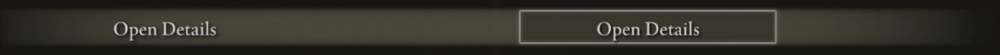
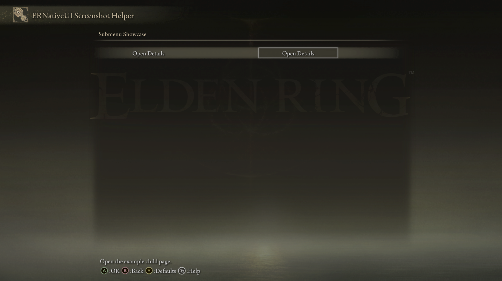
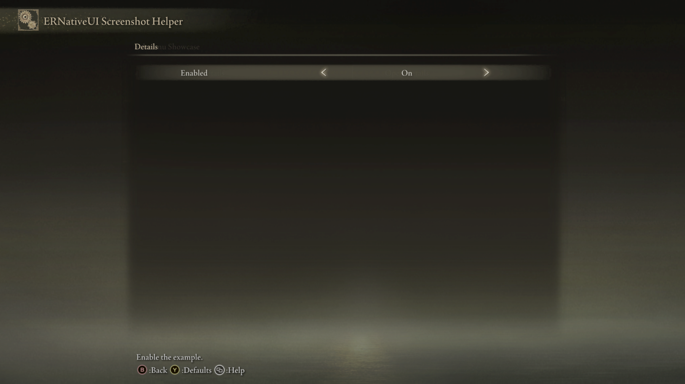

# Submenu

<table>
  <tr>
    <td align="center" valign="middle">
      <a href="../capabilities.md#what-a-capability-is"></a>
    </td>
    <td valign="middle">
      <a href="../capabilities.md#submenu"><code>submenu</code></a> ·
      <a href="../capabilities.md#updates"><code>updates</code></a> ·
      <a href="../capabilities.md#submenu-updates"><code>submenu_updates</code></a>
    </td>
  </tr>
</table>

A `Submenu` adds a navigation row to an `erui::Page`. Confirming the row opens
a new child `erui::Page` owned by the same mod. Unlike the other controls,
`Page::add_submenu` returns a typed `erui::Submenu`: it is both the child-page
builder and a retained reference that can edit the opener and page text after
registration.



*The left text is the row label. The framed action on the right opens the
child page.*

## Minimal example

This example adds the **Open Details** row shown above and puts one Toggle on
the page it opens:

```cpp
#include <ernativeui/ERNativeUI.hpp>

void add_details_submenu(erui::Page parent_page) noexcept
{
    erui::Submenu details_page = parent_page.add_submenu(
        L"Open Details",
        L"Open the example child page.",
        L"Details");

    details_page.add_toggle(
        L"Enabled",
        L"Enable the example.",
        1);
}
```

Call `add_details_submenu(menu.root())` from the menu-builder body. The
builder receives `menu` as an `erui::Menu&`, and `Menu::root()` returns the
root `erui::Page` for this mod. Passing another `erui::Page` would place the
same Submenu on that page instead. The
[first-mod guide](../../getting-started/first-mod.md) shows the complete
menu-builder context.

`parent_page.add_submenu(...)` creates two related things: the visible row on
`parent_page` and the child page represented by `details_page`. Because
`erui::Submenu` inherits the ordinary page builder, add child controls to it,
not to `parent_page`.



*The parent page contains only the `Open Details` navigation row.*



*Confirming the row opens the returned child page, where the example added its
`Enabled` Toggle.*

## API at a glance

The recommended form names the parent row and the page it opens:

```cpp
erui::Submenu child_page = parent_page.add_submenu(
    label,
    help_message,
    page_title,
    page_help);
```

Here, `parent_page` is an `erui::Page` and `child_page` is an `erui::Submenu`.
The latter can be used anywhere an ordinary page builder is expected, while
also exposing `.edit()`, `.opener_handle()`, and `.page_handle()`.

The complete C++ wrapper signature is:

```cpp
erui::Submenu erui::Page::add_submenu(
    std::wstring_view label,
    std::wstring_view help_message,
    std::wstring_view page_title = {},
    std::wstring_view page_help = {},
    bool enabled = true) noexcept;
```

When `page_title` is empty, ERNativeUI uses `label` as the child title. When
`page_help` is empty, it uses the parent row's `help_message` as the child-page
help.

## Building a larger child page

The returned page accepts the same controls as any other `erui::Page`. This
example builds an advanced page containing a Toggle and a Slider:

```cpp
#include <ernativeui/ERNativeUI.hpp>

erui::Submenu add_advanced_page(erui::Page parent_page) noexcept
{
    erui::Submenu advanced_page = parent_page.add_submenu(
        L"Advanced Settings",
        L"Open this mod's advanced settings.",
        L"My Mod - Advanced",
        L"Configure this mod's advanced behavior.");

    advanced_page.add_toggle(
        L"Enabled",
        L"Enable the advanced behavior.",
        1);

    erui::SliderOptions strength_options{};
    strength_options.minimum = 0;
    strength_options.maximum = 100;
    strength_options.step = 5;
    strength_options.initial_value = 50;

    advanced_page.add_slider(
        L"Strength",
        L"Adjust the advanced effect strength.",
        strength_options);
    return advanced_page;
}
```

Call `add_advanced_page(menu.root())` from the menu-builder body. Returning
`advanced_page` is optional, but it lets the caller add more rows or apply
[custom page presentation](../presentation-and-gfx.md#customize-submenu-titles)
before the builder finishes.

## Parameters

Submenu has no separate options object.

| Parameter | Meaning | Default or rule |
|---|---|---|
| `label` | Text shown on the parent row | Required, non-empty UTF-16; copied during the call |
| `help_message` | Contextual help for the parent row | May be empty; copied during the call |
| `page_title` | Title shown on the child page | Empty uses `label` |
| `page_help` | Logical help text owned by the child page | Empty uses `help_message` |
| [`enabled`](options/enabled.md) | Whether to include the navigation row | Defaults to `true`; `false` omits the row and makes the child unreachable |

All four strings are copied while the builder call runs. They may therefore
come from temporary or local `std::wstring` objects that remain valid for the
duration of that call.

If ERNativeUI paginates the child, its default page titles use
`page_title (n/t)`.

## Edit a committed Submenu

Retain the typed result if its presentation must change later. This example
shows where the handle and condition come from:

```cpp
erui::Submenu g_advanced_page{};
erui::Registration g_registration{};

void build_menu(erui::Menu& menu) noexcept
{
    g_advanced_page = menu.root().add_submenu(
        L"Advanced Settings",
        L"Open advanced settings.",
        L"Advanced Settings",
        L"Configure advanced behavior.");

    g_advanced_page.add_toggle(
        L"Enabled",
        L"Enable advanced behavior.",
        1);
}

ERUI_Result set_expert_mode(bool expert_mode) noexcept
{
    if (!g_registration.supports(erui::Capability::updates) ||
        !g_registration.supports(erui::Capability::submenu_updates)) {
        return ERUI_NOT_SUPPORTED;
    }

    return g_advanced_page.edit()
        .label(expert_mode ? L"Expert Settings" : L"Advanced Settings")
        .caption(expert_mode ? L"Open Expert" : L"Open Advanced")
        .help(expert_mode
            ? L"Open expert-only settings."
            : L"Open advanced settings.")
        .page_title(expert_mode ? L"Expert Settings" : L"Advanced Settings")
        .page_help(expert_mode
            ? L"Configure expert behavior."
            : L"Configure advanced behavior.")
        .commit();
}
```

`expert_mode` is an ordinary `bool` owned by the client. The successful
registration must be retained in `g_registration`; see the
[first-mod guide](../../getting-started/first-mod.md) for the complete setup.

`SubmenuEdit` is move-only and one-shot. One `commit()` atomically changes any
combination of opener label, opener help, right-side caption, child-page title,
and child-page help. Omitted fields keep their current values. Plain and
`StyledText` overloads are available for the opener label, help, and caption;
page title/help use plain text. The host copies the supplied text before
`commit()` returns, and callback-originated commits are supported.

This edit does not add or remove child rows, replace the page, or make the
Submenu eligible for ordinary-row `.interactive(...)` or `.visible(...)`.
Check the returned `ERUI_Result`; see
[Error handling](../../reference/error-handling.md).

## Capability requirements

[Reading capability requirements](../capabilities.md#reading-capability-requirements)
explains this table and how to check host support.

| Property | Value |
|---|---|
| First public API | 1.0 for registration; 1.4 for retained edits |
| Required capability | Registration: `submenu`; edits: `updates` and `submenu_updates` in addition to `submenu` |
| GFX presentation | Runtime completion supplies the matching left-label field on affected action rows; navigation does not depend on it |
| Runtime value | None; the call returns an `erui::Submenu` child-page builder/reference |

## Navigation and lifetime behavior

- `add_submenu` adds the parent action row and its child page to the same
  private registration draft.
- `erui::Submenu` is a lightweight builder/reference, not a runtime screen
  object. Populate its child rows before the menu-builder callback returns.
- Controls and nested page topology become fixed when the provider commits;
  the admitted opener/page text fields remain editable through `SubmenuEdit`.
- Elden Ring and ERNativeUI own the native navigation. Confirm opens the child;
  Back returns to the real parent; ERNativeUI adds pagination when required.
- Submenu has no value, getter, setter, or client callback.
- `enabled = false` omits the navigation row. The child is unreachable and
  neither the row nor its child controls consume a visible pagination slot.
- If the call is rejected, it returns an invalid `erui::Submenu` and causes the
  surrounding registration to fail instead of publishing a partial menu.

## Common mistakes

- Adding the intended child controls to `parent_page` instead of the returned
  child page.
- Treating the returned `Submenu` as only a row or only a page. It is the child
  page builder during registration and the stable edit reference afterward.
- Retaining the `Submenu` after registration and trying to add rows dynamically;
  only its documented presentation fields are mutable.
- Expecting `enabled = false` to render a disabled navigation row.
- Building manual Back, Previous, or Next buttons instead of letting
  ERNativeUI own navigation and pagination.
- Confusing `page_title` with the optional outer `menu_title` configured by
  page presentation.

[Controls index](README.md) |
[Reverse-engineering reference](../../research/case-studies/settings-pages-and-pagination.md) |
Previous: [Button](button.md) |
Next: [Toggle](toggle.md)
