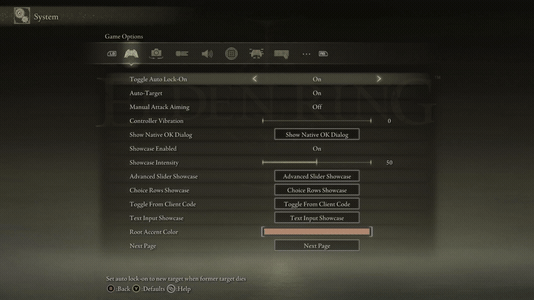
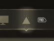
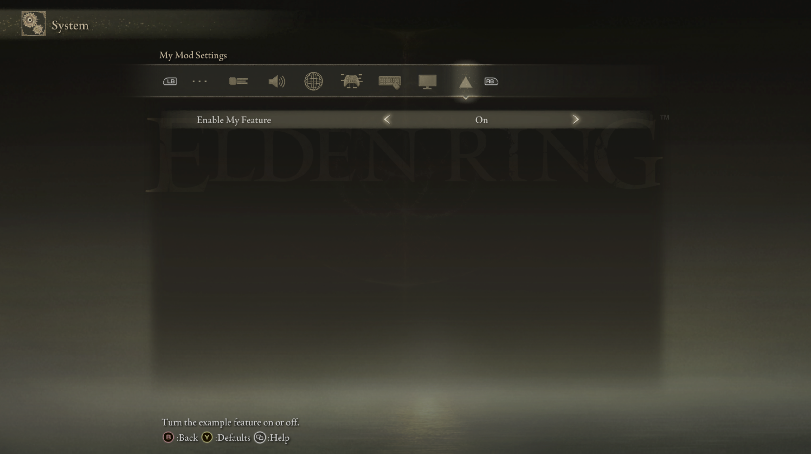

# Custom Configuration tabs

<table>
  <tr>
    <td align="center" valign="middle">
      <a href="capabilities.md#what-a-capability-is"></a>
    </td>
    <td valign="middle">
      <a href="capabilities.md#custom-tabs"><code>custom_tabs</code></a>
    </td>
  </tr>
</table>

API 1.3 lets a client mod add its own top-level tab to Elden Ring's
**System** screen. The tab receives an ordinary ERNativeUI page, so it can
contain the same settings controls and automatic pagination as a submenu or a
built-in page.



*Custom tabs share the native System strip. ERNativeUI reveals additional tabs
through its overflow navigation.*

This guide is for mod authors. It explains how to use the public API without
requiring any knowledge of Elden Ring's UI objects or ERNativeUI's hooks.

## Find what you need

| You want to... | Go to... |
|---|---|
| Add a top-level tab to System | [Create a custom tab](#create-a-custom-tab) |
| Give the tab an icon without loading a file | [Create the icon in code](#create-the-icon-in-code) |
| Use a PNG or another existing image | [Convert an existing image](#convert-an-existing-image) |
| Connect and register the menu safely | [Check capabilities and register](#check-capabilities-and-register) |
| Add settings controls to the tab | [Add controls to the tab](#add-controls-to-the-tab) |
| Translate the title and rows | [Localize player-facing text](#localize-player-facing-text) |
| Choose stable IDs and tab order | [Choose identity and ordering](#choose-identity-and-ordering) |
| Understand overflow and mouse navigation | [Overflow navigation](#overflow-navigation) |
| Diagnose a problem | [Troubleshooting](#troubleshooting) |
| Study how the native implementation was recovered | [Reverse-engineering case study](../research/case-studies/custom-tabs.md) |

Custom tabs require ERUI API 1.3, first shipped by ERNativeUI 1.3.0. Package
versions and ERUI API versions are independent; a later compatible 1.x release
may retain API 1.3 unchanged. See [Versioning](../versioning.md).

## Create a custom tab

Create the tab inside the same one-time `register_menu` builder used for every
other ERNativeUI page:

```cpp
#include <ernativeui/ERNativeUI.hpp>

void build_menu(erui::Menu& menu) noexcept
{
    erui::TabOptions tab{};
    tab.tab_id = "settings";
    tab.title = L"My Mod Settings";

    erui::Page page = menu.add_tab(tab);
    if (!page.valid()) return;

    page.add_toggle(
        L"Enable My Feature",
        L"Turn this mod feature on or off.",
        1);
}
```

That is the complete tab declaration:

- `tab_id` is the stable name ERNativeUI uses to identify this tab inside the
  provider;
- `title` is the text shown to the player; and
- `menu.add_tab` returns the page that receives the mod's controls.

With no icon supplied, ERNativeUI uses its default triangle icon. The next
section adds a custom image without introducing an image-loading dependency.

## Create the icon in code

A tab icon is a 32x32 array of pixels. Each pixel uses four bytes: red, green,
blue and opacity. An opacity of `0` is invisible, `255` is fully visible, and
values between them are translucent.

The following function generates a simple triangle in `rgb(107, 100, 80)` on
a transparent background. It uses only the C++ standard library, and every
value used by the tab is defined in the snippet:

```cpp
#include <array>
#include <cstddef>
#include <cstdint>
#include <ernativeui/ERNativeUI.hpp>

using TabIconPixels =
    std::array<std::uint8_t, ERUI_TAB_ICON_RGBA8_BYTE_COUNT>;

[[nodiscard]] constexpr TabIconPixels make_triangle_tab_icon() noexcept
{
    constexpr std::uint8_t red = 107;
    constexpr std::uint8_t green = 100;
    constexpr std::uint8_t blue = 80;
    constexpr std::size_t top = 4;
    constexpr std::size_t bottom = 27;

    TabIconPixels pixels{};
    for (std::size_t y = 0; y < ERUI_TAB_ICON_HEIGHT; ++y) {
        if (y < top || y > bottom) continue;

        // The permitted distance from the centre grows on each row.
        const int maximum_distance = static_cast<int>(y - top) + 1;

        for (std::size_t x = 0; x < ERUI_TAB_ICON_WIDTH; ++x) {
            // Doubled coordinates place the centre between columns 15 and
            // 16, keeping the triangle symmetric without using floats.
            const int from_centre = static_cast<int>(x * 2U + 1U) - 32;
            const int distance =
                from_centre < 0 ? -from_centre : from_centre;
            if (distance > maximum_distance) continue;

            // A translucent one-pixel boundary softens the diagonal edges.
            const bool boundary =
                distance + 2 > maximum_distance || y == bottom;
            const std::uint8_t opacity = boundary ? 160 : 255;

            const std::size_t offset =
                (y * ERUI_TAB_ICON_WIDTH + x) * 4U;
            pixels[offset + 0U] = red;
            pixels[offset + 1U] = green;
            pixels[offset + 2U] = blue;
            pixels[offset + 3U] = opacity;
        }
    }
    return pixels;
}

inline constexpr TabIconPixels kTriangleIcon = make_triangle_tab_icon();
```

The generated pixel data produces the triangle shown below:



Assign that array before calling `menu.add_tab`:

```cpp
erui::TabOptions tab{};
tab.tab_id = "settings";
tab.title = L"My Mod Settings";
tab.icon = {
    kTriangleIcon.data(),
    kTriangleIcon.size(),
    erui::TabIconFormat::rgba8};

erui::Page page = menu.add_tab(tab);
```

`TabIconFormat::rgba8` supports every opacity value, including a completely
opaque image whose pixels all use `255`. There is no separate format to choose
for transparency.

The host copies all 4,096 bytes during `menu.add_tab`, so the client does not
need to keep the source buffer alive after the call. Leaving `tab.icon` empty
selects the default triangle icon.

The buildable
[Showcase Screenshot Helper](../../examples/showcase_screenshot_helper/README.md)
uses this exact triangle generator in its `custom-tab` mode.



### Exact pixel contract

| Property | Required value |
|---|---|
| Dimensions | 32x32 pixels |
| Layout | Row by row, left to right and then top to bottom |
| Bytes per pixel | Red, green, blue, opacity |
| Row size | 128 bytes with no padding |
| Total size | 4,096 bytes (`ERUI_TAB_ICON_RGBA8_BYTE_COUNT`) |

## Convert an existing image

`TabOptions::icon` receives decoded pixels, not a filename. PNG and JPEG files
are compressed image containers and cannot be passed directly. Decode the
file, resize it to 32x32, convert it to RGBA byte order, and then give the
resulting 4,096 bytes to ERNativeUI.

One convenient build-time option is a small Python/Pillow script that converts
`my-tab.png` into a C++ header:

```python
from pathlib import Path
from PIL import Image

source = Image.open("my-tab.png").convert("RGBA")
source = source.resize((32, 32), Image.Resampling.LANCZOS)
pixels = source.tobytes()

values = ", ".join(f"0x{value:02X}" for value in pixels)
Path("my_tab_icon.hpp").write_text(
    "#pragma once\n"
    "#include <array>\n#include <cstdint>\n"
    "inline constexpr std::array<std::uint8_t, 4096> "
    f"kMyTabIcon{{{{{values}}}}};\n",
    encoding="utf-8",
)
```

Include the generated header and assign its array exactly like the triangle:

```cpp
#include "my_tab_icon.hpp"

tab.icon = {
    kMyTabIcon.data(),
    kMyTabIcon.size(),
    erui::TabIconFormat::rgba8};
```

Pillow is only a build-time example. It is not required by ERNativeUI and does
not need to ship with the mod. A client may instead use:

- a procedural `std::array<std::uint8_t, 4096>`;
- an exact 4,096-byte raw resource embedded in the DLL;
- a file decoded by the mod's existing image library; or
- a `std::vector<std::uint8_t>` filled by another image pipeline.

Windows DIB/BMP pixels are commonly stored in blue, green, red, opacity order
and may run from the bottom row upward. Convert them to the contract above
before calling `menu.add_tab`.

## Check capabilities and register

Check the capability on the established connection before registration. A
valid API 1.3 connection can still omit custom tabs when the installed Elden
Ring executable has not passed the host's native validation:

```cpp
erui::Registration g_registration{};

void register_ui() noexcept
{
    const auto connection = erui::connect();
    if (!connection) return;

    if (!connection.value().supports(erui::Capability::custom_tabs)) {
        return;
    }

    erui::ProviderOptions provider{};
    provider.provider_id = "my-mod";
    provider.display_name = L"My Mod";
    provider.owner_module = g_module;

    const auto registered =
        connection.value().register_menu(provider, build_menu);
    if (!registered) return;

    g_registration = registered.value();
}
```

`g_module` is the client's module handle captured by its normal `DllMain`
entry point. Run `register_ui` from a startup worker after `DllMain` returns;
do not connect or register while Windows holds the loader lock. The
[client-mod template](../../examples/template/README.md) provides that complete
worker and module setup.

Retain the successful `Registration` for later row reads, writes and alerts.
Registration is transactional: if the builder fails, ERNativeUI publishes
none of that provider's draft tabs or rows.

## Add controls to the tab

The page returned by `menu.add_tab` supports the ordinary control builders:

```cpp
erui::Page page = menu.add_tab(tab);
if (!page.valid()) return;

page.add_button<&apply_settings>(
    L"Apply",
    L"Apply this mod's current settings.");

erui::SliderOptions strength{};
strength.minimum = 0;
strength.maximum = 100;
strength.step = 5;
strength.initial_value = 50;

page.add_slider(
    L"Strength",
    L"Adjust this mod's effect strength.",
    strength,
    &strength_changed);
```

If the page contains more rows than the native panel can display, ERNativeUI
creates Previous and Next slices automatically. Add controls in their desired
logical order; do not add pagination rows yourself. See
[Menus, pages, and pagination](menus-and-pages.md) and the
[control guides](controls/README.md).

## Localize player-facing text

Translate the visible title, provider name, row labels and row help. Keep the
machine IDs unchanged:

```cpp
struct Text {
    std::wstring_view provider_name;
    std::wstring_view tab_title;
};

constexpr Text kEnglish{L"My Mod", L"My Mod Settings"};
constexpr Text kFrench{L"Mon mod", L"Paramètres de mon mod"};

const Text& text_for(const erui::LanguageInfo& language) noexcept
{
    return language.available() &&
            language.known == erui::GameLanguage::french
        ? kFrench
        : kEnglish;
}

const erui::LanguageInfo language = connection.value().game_language();
const Text& text = text_for(language);

provider.display_name = text.provider_name;

const auto registered = connection.value().register_menu(
    provider,
    [&text](erui::Menu& menu) noexcept {
        erui::TabOptions tab{};
        tab.tab_id = "settings";       // Stable and never translated.
        tab.title = text.tab_title;    // Player-facing and translated.

        erui::Page page = menu.add_tab(tab);
        if (!page.valid()) return;

        // Add rows selected from the same translation table here.
    });
```

ERNativeUI translates only its own navigation text. Each client owns its title
and row translations plus its fallback policy. The effective language and
menu topology are fixed for the process, so restart the game after changing
language. See [Game language and localization](localization.md) for the full
selection pattern.

## Choose identity and ordering

The provider and tab IDs identify the tab; they are not labels:

```cpp
provider.provider_id = "my-mod";
tab.tab_id = "settings";
```

Together they form the diagnostic and player-ordering key:

```text
my-mod/settings
```

Both components are case-sensitive and accept 1..255 ASCII letters, digits,
`.`, `_` or `-`. `/` separates the two components. Keep both IDs stable across
releases and never translate them. `tab_id` is local to its provider, so a
different mod may also use `settings` without a collision.

Set `preferred_order` to suggest a position among custom tabs:

```cpp
tab.preferred_order = 100;
```

Lower values appear first. Equal values are resolved deterministically by
provider ID and then tab ID. Elden Ring's eight stock tabs remain before the
custom catalogue. `ProviderOptions::root_priority` orders provider content on
shared pages; it does not order custom tabs.

Players may override the hint in `ERNativeUI.ini`:

```ini
[TabOrder]
my-mod/settings = 10
another-mod/main = 20
```

The resolved keys and order are written to `ERNativeUI-tabs.log` only when
`[Logging] EnableLog = 1`. A client should never edit the player's host INI.

## Overflow navigation

When every logical tab cannot fit in the native strip, ERNativeUI displays
`...` at the hidden edges and shifts the visible window as the player moves.
The shared host owns L1/R1 navigation, held repeat, wrapping, pointer selection
and stationary mouse dwell. A client contributes only real tabs; it must not
create placeholder or overflow entries.

Do not confuse physical slots with logical custom tabs. The player can request
8, 9, or 10 physical slots through `[Tabs] MinimumTabSlots`; ten is the hard
native ceiling. The host can still merge up to 1,024 logical custom tabs and
uses the same viewport to expose everything beyond the visible strip. Client
mods do not inspect or change this player preference.

Players can tune the navigation margin and mouse-dwell timing in
`ERNativeUI.ini`. Those are host-wide preferences, not per-client settings.

## Registration, limits and lifetime

- Tab/page topology and row descriptors are registered once during startup
  and cannot be changed after commit. Supported row values remain readable and
  writable through the retained `Registration`.
- A title is required and may contain at most 95 UTF-16 code units.
- IDs and visible text must not contain embedded NULs.
- The process-wide ceiling is 1,024 committed custom tabs across all
  providers, not 1,024 per mod.
- Duplicate tab IDs inside one provider fail with `ERUI_DUPLICATE_TAB_ID`.
- Exhausted process capacity fails with `ERUI_TAB_LIMIT_REACHED`.
- Invalid identity, title or icon data fails with `ERUI_INVALID_ARGUMENT`.
- An unavailable native backend fails with `ERUI_NOT_SUPPORTED`.

Other ordinary registration failures can still occur. The C++ wrapper records
the first builder failure and aborts the complete provider draft instead of
publishing only the operations that succeeded first.

The host owns copied IDs, titles, page models and icon bytes. Callback code and
callback state follow the ordinary process-lifetime rules, and committed
client DLLs cannot be hot-unloaded safely. See
[Lifecycle, errors, and limits](../reference/lifecycle-errors-and-limits.md)
for the complete ownership and error contract.

## Strict-C equivalent

The C11 surface uses `ERUI_TabIconDesc`, `ERUI_TabDesc` and
`ERUI_Api::add_tab`. Zero-initialize every descriptor, set its `size`, leave
flags and reserved fields at zero, and test `ERUI_CAP_CUSTOM_TABS` first. This
fragment assumes the API, provider, pixel buffer and localized title are ready:

```c
ERUI_PageHandle page = ERUI_INVALID_PAGE;

ERUI_TabIconDesc icon = {0};
icon.size = sizeof(icon);
icon.format = ERUI_TAB_ICON_FORMAT_RGBA8;
icon.byte_count = ERUI_TAB_ICON_RGBA8_BYTE_COUNT;
icon.pixels = my_icon_rgba8;

ERUI_TabDesc tab = {0};
tab.size = sizeof(tab);
tab.tab_id.data = "settings";
tab.tab_id.length = 8;
tab.title.data = my_localized_title_utf16;
tab.title.length = my_localized_title_length;
tab.preferred_order = 100;
tab.icon = &icon;

if ((api.capabilities & ERUI_CAP_CUSTOM_TABS) != 0) {
    ERUI_Result result = api.add_tab(provider, &tab, &page);
    if (result == ERUI_OK) {
        /* Add ordinary rows to page with api.add_toggle, api.add_slider, ... */
    }
}
```

Set `tab.icon` to `NULL` for the default triangle icon. As in C++, the host
copies the descriptor and pixels before `add_tab` returns. The strict-C header
is the normative ABI contract.

## Troubleshooting

| Symptom | Check |
|---|---|
| No custom tab appears | Check the API 1.3 connection, `Capability::custom_tabs`, registration result and supported game build |
| Registration reports an invalid argument | Verify the ID, non-empty title, 32x32 dimensions and exact 4,096-byte pixel count |
| Colors appear swapped | Convert source data to red, green, blue, opacity byte order |
| The icon has an unexpected solid background | Verify that the generated or decoded opacity bytes are not all `255` |
| Two tabs collide | Give them distinct provider-local `tab_id` values |
| Order differs from the hint | Check the player's `[TabOrder]` entries and `ERNativeUI-tabs.log` |
| A long page has multiple slices | This is automatic pagination; do not add client-owned Previous/Next rows |

Enable ordinary logging while diagnosing registration. Detailed diagnostics
can significantly slow the game, especially with many tabs or icons, so use
them only for a focused capture and disable them afterward.

For implementation evidence rather than client instructions, read the
[Configuration custom-tabs reverse-engineering case study](../research/case-studies/custom-tabs.md).

Return to the [mod-author guides](README.md).
