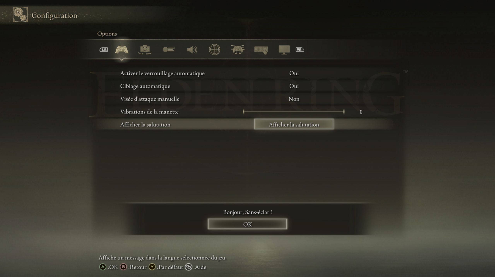

# Game language and localization

<table>
  <tr>
    <td align="center" valign="middle">
      <a href="capabilities.md#what-a-capability-is"></a>
    </td>
    <td valign="middle">
      <a href="capabilities.md#game-language"><code>game_language</code></a>
    </td>
  </tr>
</table>

ERNativeUI reports one process-wide effective language so a client mod can
choose its own translated text. It follows Elden Ring's selected Steam game
language by default, while an optional `ERNativeUI.ini` setting can select an
explicit locale for the host and every client. ERNativeUI does not translate
provider names, row labels, help text, choice values, or dialog messages for
the client.

This guide describes the current C++17 surface. Language discovery
first appeared in API 1.0 and remains available to any client built with the
1.0 SDK. A client that chooses API 1.1 uses its explicit connection lifecycle.
API versions and ERNativeUI release versions are independent. See the
[feature matrix](../features.md) and [versioning guide](../versioning.md).

## What ERNativeUI provides

The language API returns both:

- a known-language enum for every language currently advertised for Elden
  Ring on Steam; and
- the exact effective UTF-8 identifier, including a configured, future, or
  community identifier that the current enum does not recognize yet.

The known C++ values are `english`, `german`, `french`, `italian`, `korean`,
`spanish`, `chinese_simplified`, `chinese_traditional`, `russian`, `thai`,
`japanese`, `polish`, `arabic`, `portuguese_brazil`, and
`spanish_latin_america`. `GameLanguage::unknown` is a valid forward-compatible
classification, not necessarily an error.

In automatic mode ERNativeUI reads only Steam's current game-language
identifier. It does not infer a language from the Windows locale, report the
audio language, enumerate available languages, or change the language while
the game is running.

## Choose automatic detection or an explicit locale

The default file beside `ERNativeUI.dll` contains:

```ini
[Localization]
Language = auto
```

`auto` waits only as long as necessary for Elden Ring's Steam service, then
uses the exact identifier returned by
`SteamAPI_ISteamApps_GetCurrentGameLanguage`.

To test or force another installed locale, use its exact lowercase identifier:

```ini
[Localization]
Language = vietnamese
```

An explicit identifier:

- is selected immediately, without waiting for Steam language discovery;
- chooses `locales/vietnamese.ini` for ERNativeUI-owned navigation text; and
- is returned as `LanguageInfo::identifier` to every connected client mod.

This does not change Elden Ring's own language. Every client still decides
whether it has translations for that identifier. For example, `vietnamese`
currently produces `GameLanguage::unknown` because the convenience enum
mirrors the languages advertised for Elden Ring, but the exact
`"vietnamese"` identifier remains available for a client to match.

The shipped Tarnished UI Showcase demonstrates that forward-compatible path:
it checks the exact identifier for `vietnamese`, supplies Vietnamese client
text, and otherwise continues using the convenience enum plus English
fallback. The host's `assets/locales/vietnamese.ini` independently translates
host-owned Previous/Next navigation.

Explicit identifiers contain 1–64 ASCII lowercase letters, digits, `_`, or
`-`. `auto` is reserved. An invalid or empty value logs a warning when logging
is enabled and safely falls back to automatic detection. Changes take effect
after a complete game restart.

## Connect before selecting text

Call `erui::connect()` from a worker after `DllMain` returns. A successful API
1.1-or-later connection means startup language selection has settled, either with a
valid effective language or with a definitive unavailable result in automatic
mode. Query the language before registration when the provider display name
also needs translation.

This example selects English or French text and retains English as its
fallback:

```cpp
#include <ernativeui/ERNativeUI.hpp>

struct Text {
    std::wstring_view mod_name;
    std::wstring_view show_notice;
    std::wstring_view notice;
};

constexpr Text kEnglish{
    L"My Mod",
    L"Show Notice",
    L"Apply the recommended settings?",
};

constexpr Text kFrench{
    L"Mon mod",
    L"Afficher le message",
    L"Appliquer les paramètres recommandés ?",
};

const Text& select_text(const erui::LanguageInfo& language) noexcept
{
    if (!language.available()) {
        return kEnglish;
    }

    switch (language.known) {
    case erui::GameLanguage::french:
        return kFrench;
    default:
        break;
    }

    // A mod may recognize a future or community token before ERNativeUI does.
    // Compare language.identifier here, then retain an English fallback.
    return kEnglish;
}

void initialize_menu() noexcept
{
    erui::ConnectionResult connection_result = erui::connect();
    if (!connection_result) {
        // Disable only this mod's optional ERNativeUI integration.
        return;
    }

    const erui::Connection& connection = connection_result.value();
    const erui::LanguageInfo language = connection.game_language();
    const Text& text = select_text(language);

    erui::ProviderOptions options{};
    options.provider_id = "my-mod";
    options.display_name = text.mod_name;
    options.owner_module = g_module;

    // Register the menu through `connection`. Use text.show_notice for the
    // row label and text.notice for the dialog message.
}
```

The registration builders copy all selected visible text synchronously, so
they do not retain the `std::wstring_view` objects passed by this table.

The [first-mod guide](../getting-started/first-mod.md) shows the complete
connection and registration flow. For a compact complete localization
implementation, see the
[Localized Greeting example](../../examples/localized_greeting/README.md).

## Understand `LanguageInfo`

Use `available()`, `known`, and `identifier` together:

| Result | Meaning | Recommended behavior |
|---|---|---|
| `available()` is false | Automatic Steam discovery was definitively unavailable | Use the mod's English fallback |
| `available()` is true and `known` is recognized | ERNativeUI knows the effective identifier | Select the matching translation |
| `available()` is true and `known` is `unknown` | A configured, future, or community identifier is valid but not in the enum | Inspect `identifier`, then fall back if the mod does not recognize it |

Useful exact Steam tokens include `french`, `koreana`, `brazilian`, and
`latam`. Do not manufacture these tokens from the known enum or from the
Windows locale. Treat `identifier` as the authority.

The C++ `LanguageInfo` owns its `identifier` string, so the returned object can
be retained by the client. In the strict C surface,
`ERUI_GameLanguageInfo.identifier` points to immutable host-owned memory valid
until process exit. Initialize the C structure's `size` before calling
`ERUI_Api::get_game_language`.

## Decide which text the mod translates

A client normally uses the selected table for all text it contributes:

- provider display names;
- page titles;
- row labels and help messages;
- Inline Choice and Popup Choice values;
- TextInput placeholders; and
- native dialog messages.

Elden Ring supplies and localizes native UI text that belongs to the game,
including a dialog's **OK**, **CANCEL**, **YES**, and **NO** button captions.
The client still translates the message inside that dialog. See
[Native dialogs](native-dialogs.md) for the alert API and response behavior.

ERNativeUI's host locale files translate only ERNativeUI-owned text such as
pagination labels. They do not translate client content.



*A client selects its own strings from the language returned by the established
ERNativeUI connection.*

## Steam integration and failure behavior

In automatic mode ERNativeUI reads the already initialized Steamworks service
with ordinary read-only flat-C calls. It does not initialize Steam, hook Steam
functions, or use a game RVA for language discovery. An explicit language
override bypasses that lookup and the configured `SteamLanguageWaitMs`.

Failure to discover a language in automatic mode does not disable menus or
unrelated ERNativeUI features. Treat it as a request to use the client mod's
fallback language. The effective result is fixed for the game process;
changing Steam's language or `Localization.Language` requires a restart.

## Research trail

The public API hides Steam startup timing, interface acquisition, and the
host's cached representation. The
[Steam language case study](../research/case-studies/steam-language.md) records
the reproducible evidence behind the API boundary. It is supporting research,
not an additional client API.

Return to the [mod-author guides](README.md) or continue with
[Native dialogs](native-dialogs.md).
