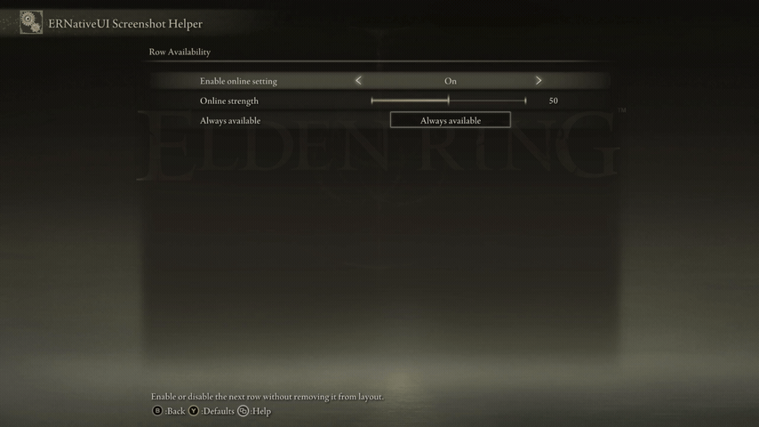

# Enable or disable rows at runtime

<table>
  <tr>
    <td align="center" valign="middle">
      <a href="../capabilities.md#what-a-capability-is"></a>
    </td>
    <td valign="middle">
      <a href="../capabilities.md#updates"><code>updates</code></a> ·
      <a href="../capabilities.md#row-availability"><code>row_availability</code></a>
    </td>
  </tr>
</table>

Use `.interactive(bool)` when a row should remain visible but the player must
not be able to focus, activate, or change it. Disabled rows keep their layout
and pagination slot.

This page is specifically about **runtime row availability**: whether one
visible row accepts focus and input, and how its enabled or disabled state is
presented. It is separate from host feature
[capabilities](../capabilities.md#what-a-capability-is). If `row.edit()`,
`commit()`, or typed rows are new to you, read the
[row-update foundation](README.md) first.



*Online Strength stays in the page, but navigation skips it while the server
is disconnected.*

## Complete example

The example below adds two rows:

- `Server connected` is a demonstration Toggle. Its callback receives `0`
  for Off and `1` for On.
- `Online strength` is the Slider that becomes enabled or disabled.

The function receives the valid `erui::Connection` and configured
`erui::ProviderOptions` created during ordinary startup. See
[Build your first client mod](../../getting-started/first-mod.md) for that
process-wide setup.

Both typed row objects and the ordinary C++ `bool` live in client-owned state:

```cpp
#include <ernativeui/ERNativeUI.hpp>

namespace {

struct AvailabilityUi {
    erui::ToggleRow connection_switch{};
    erui::SliderRow online_strength{};
    erui::Registration registration{};
    bool server_connected{false};
};

AvailabilityUi g_ui;

ERUI_Result apply_server_availability(bool connected) noexcept
{
    g_ui.server_connected = connected;

    // Only interaction is changed. The initial appearance policy already
    // follows interaction, so false also selects the native disabled look.
    return g_ui.online_strength.edit()
        .interactive(g_ui.server_connected)
        .commit();
}

void ERUI_CALL connection_changed(void*, std::uint8_t value) noexcept
{
    const bool connected = value != 0;
    const ERUI_Result result = apply_server_availability(connected);

    if (result != ERUI_OK) {
        // Log the numeric result or report it through your mod's logger.
    }
}

bool register_availability_rows(
    const erui::Connection& connection,
    const erui::ProviderOptions& provider_options) noexcept
{
    if (!connection.supports(erui::Capability::toggle) ||
        !connection.supports(erui::Capability::slider) ||
        !connection.supports(erui::Capability::updates) ||
        !connection.supports(erui::Capability::row_availability)) {
        return false;
    }

    const auto registered = connection.register_menu(
        provider_options,
        [](erui::Menu& menu) noexcept {
            auto page = menu.root();

            g_ui.connection_switch = page.add_toggle(
                L"Server connected",
                L"Demonstrate a dependency controlled at runtime.",
                0, // Initial Toggle value: Off.
                &connection_changed);

            erui::SliderOptions strength{};
            strength.minimum = 0;
            strength.maximum = 100;
            strength.step = 5;
            strength.initial_value = 50;

            g_ui.online_strength = page.add_slider(
                L"Online strength",
                L"Available only while connected to the server.",
                strength);
        });

    if (!registered) {
        return false;
    }

    g_ui.registration = registered.value();

    // Typed rows become editable only after registration succeeds.
    return apply_server_availability(false) == ERUI_OK;
}

} // namespace
```

`g_ui.online_strength` comes from `Page::add_slider`; it is an
`erui::SliderRow`, not a native Scaleform pointer. `g_ui.server_connected` is
a normal `bool` owned by this example. In a real online mod, call
`apply_server_availability(...)` from your connection-state callback instead
of exposing the demonstration Toggle.

## Is `availability_appearance(...)` mandatory?

No. Interaction and appearance are separate fields, and omitted fields keep
their current state.

Every newly materialized row initially uses
`erui::AvailabilityAppearance::follow_interactivity`. Therefore the ordinary
case needs only:

```cpp
const ERUI_Result result = g_ui.online_strength.edit()
    .interactive(g_ui.server_connected)
    .commit();
```

Here `g_ui.online_strength` is the retained `erui::SliderRow` and
`g_ui.server_connected` is the client-owned `bool` declared in the complete
example. When the Boolean is `false`, navigation skips the row and the
default policy makes it look disabled. When it is `true`, normal interaction
and presentation return.

Set the appearance explicitly when you want to override or restore that
policy:

```cpp
const ERUI_Result result = g_ui.online_strength.edit()
    .interactive(g_ui.server_connected)
    .availability_appearance(
        erui::AvailabilityAppearance::follow_interactivity)
    .commit();
```

The second setter is useful if an earlier edit forced `normal` or `disabled`.
It is not required for every enable/disable operation.

## Choose interaction and appearance independently

`AvailabilityAppearance` changes presentation only; it never changes input
eligibility:

| Value | Presentation |
|---|---|
| `follow_interactivity` | Normal while interactive; disabled-looking while non-interactive. This is the initial default. |
| `normal` | Force normal presentation, even if the row cannot be focused. |
| `disabled` | Force disabled presentation, even if the row remains interactive. |

For example, this creates a read-only row that deliberately keeps its normal
appearance:

```cpp
const ERUI_Result result = g_ui.online_strength.edit()
    .interactive(false)
    .availability_appearance(erui::AvailabilityAppearance::normal)
    .commit();
```

Calling only `.availability_appearance(...)` would not disable the row.
Calling only `.interactive(...)` preserves whichever appearance policy is
currently stored.

## Focus and callback behavior

It is safe to call `edit().commit()` from an ERNativeUI callback, including
the callback of the row being disabled. The callback finishes against the
current native generation; ERNativeUI applies the accepted edit afterward at
a UI-safe boundary and restores valid focus. Back remains usable even when no
content row is interactive.

## Supported rows and construction caveats

Runtime availability supports materialized Button, Toggle, byte Slider,
Numeric Slider, Custom Slider, Inline Choice, Popup Choice, TextInput, and
ColorPicker rows. Submenu is deliberately excluded.

The `enabled` argument or option passed during registration chooses the
initial interaction state; `.interactive(...)` is the runtime operation.
Construction-disabled Button and ColorPicker rows can be omitted by their
native construction paths, leaving no materialized target to enable later.
When later enablement is required, register a materialized row and submit an
initial `.interactive(false)` edit after registration succeeds.

Use [visibility](visibility.md) instead when the unavailable row should also
stop consuming layout space.

[Row-update foundation](README.md) | [Visibility](visibility.md)
