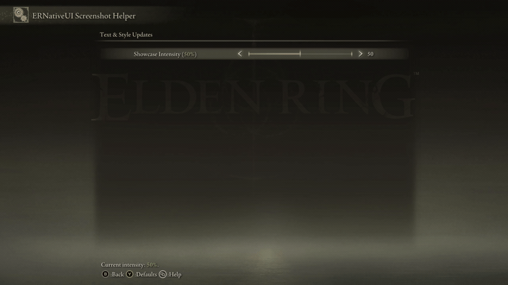
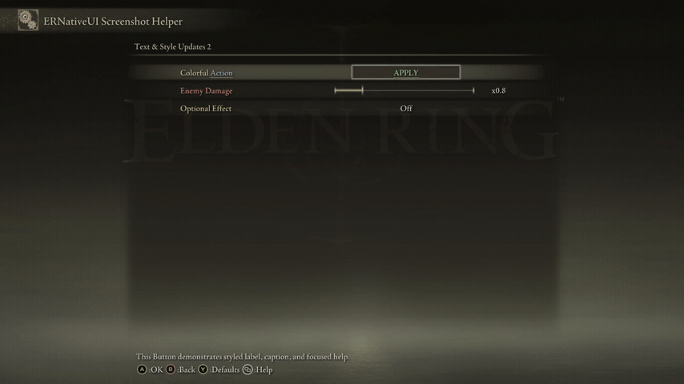

# Change row text and style at runtime

<table>
  <tr>
    <td align="center" valign="middle">
      <a href="../capabilities.md#what-a-capability-is"></a>
    </td>
    <td valign="middle">
      <a href="../capabilities.md#updates"><code>updates</code></a>
    </td>
  </tr>
</table>

This page focuses on presentation updates. If typed rows, edit drafts,
or `commit()` are new to you, read the
[row-update foundation](README.md) first.

`label(...)` changes the left-hand row text. `help(...)` changes the footer
shown while the row has focus. Button and Popup Choice additionally expose
`caption(...)` for text inside their right-hand control.

For the exact styling operations and their scope, see the
[`erui::TextStyle` reference](#eruitextstyle-reference).



*The Intensity callback updates its own label and help, interpolating the
percentage from red at 0% to green at 100%.*

## Update label and help together

The complete example below retains the `erui::SliderRow` returned by
`add_slider`. Every player change updates the percentage in both the label and
focused help:

```cpp
#include <ernativeui/ERNativeUI.hpp>

#include <string>
#include <utility>

struct TextStyleUi {
    erui::SliderRow intensity{};
    erui::Registration registration{};
};

TextStyleUi g_ui;

erui::Color intensity_color(std::uint8_t value) noexcept
{
    const auto progress = static_cast<std::uint32_t>(value);
    return {
        static_cast<std::uint8_t>(255U - 191U * progress / 100U),
        static_cast<std::uint8_t>(64U + 191U * progress / 100U),
        64U,
    };
}

ERUI_Result update_intensity_text(std::uint8_t value) noexcept
{
    const std::wstring percentage =
        std::to_wstring(static_cast<unsigned>(value)) + L"%";

    const auto style =
        erui::TextStyle{}.color(intensity_color(value));

    auto label = erui::StyledText{}
        .append(L"Showcase Intensity (")
        .append(percentage, style)
        .append(L")");

    auto help = erui::StyledText{}
        .append(L"Current intensity: ")
        .append(percentage, style)
        .append(L".");

    return g_ui.intensity.edit()
        .label(std::move(label))
        .help(std::move(help))
        .commit();
}

void ERUI_CALL intensity_changed(void*, std::uint8_t value) noexcept
{
    const ERUI_Result result = update_intensity_text(value);
    if (result != ERUI_OK) {
        // Log or otherwise handle the rejected presentation update.
    }
}

bool register_intensity_row(
    const erui::Connection& connection,
    const erui::ProviderOptions& provider_options) noexcept
{
    if (!connection.supports(erui::Capability::slider) ||
        !connection.supports(erui::Capability::updates)) {
        return false;
    }

    constexpr std::uint8_t initial_intensity = 50;
    const auto registered = connection.register_menu(
        provider_options,
        [initial_intensity](erui::Menu& menu) noexcept {
            erui::SliderOptions options{};
            options.minimum = 0;
            options.maximum = 100;
            options.step = 5;
            options.initial_value = initial_intensity;

            g_ui.intensity = menu.root().add_slider(
                L"Showcase Intensity",
                L"Move the slider to update its label and help text.",
                options,
                &intensity_changed);
        });

    if (!registered) {
        return false;
    }

    g_ui.registration = registered.value();

    // Call the same presentation helper once for the initial value.
    return update_intensity_text(initial_intensity) == ERUI_OK;
}
```

At `0%` the fragment is RGB `(255, 64, 64)`. At `100%` it is RGB
`(64, 255, 64)`. Intermediate values use linear RGB interpolation. Only the
percentage fragment is colored; the surrounding native text keeps its
ordinary focus and disabled behavior.

`value` is a byte because this Slider has a `0..100` range. The callback
receives the new player-selected value; it is not a string. `g_ui.intensity`
comes from `Page::add_slider` and becomes safe to edit after
`register_menu` succeeds.

## Style several control families

The screenshot helper's `row-text-and-styles-2` mode complements the focused
Intensity example with three distinct controls:

- a Button whose row label, control caption, and focused help use independent
  colored and underlined spans;
- a Numeric Slider whose complete label is red below its `x1.0` default,
  native-colored exactly at the default, and green above it; and
- a Toggle whose complete label is gold while Off and returns to the native
  color while On.

The Numeric Slider deliberately uses a `0.5..2.0` range, so its `x1.0`
semantic default is not the visual midpoint. Its callback compares the exact
scaled integer against `10` rather than comparing floating-point values.

```cpp
erui::ButtonRow colorful_action{};
erui::NumericSliderRow enemy_damage{};
erui::ToggleRow optional_effect{};

void do_nothing() noexcept {}

ERUI_Result style_colorful_action() noexcept
{
    const auto gold =
        erui::TextStyle{}.color(erui::Color{218, 185, 98});
    const auto blue_underlined = erui::TextStyle{}
        .color(erui::Color{96, 180, 255})
        .underline();
    const auto green_underlined = erui::TextStyle{}
        .color(erui::Color{96, 220, 128})
        .underline();

    auto label = erui::StyledText{}
        .append(L"Colorful ", gold)
        .append(L"Action", blue_underlined);
    auto caption = erui::StyledText{}
        .append(L"APPLY", green_underlined);
    auto help = erui::StyledText{}
        .append(L"The label, ", gold)
        .append(L"caption", green_underlined)
        .append(L", and help use independent styles.");

    return colorful_action.edit()
        .label(std::move(label))
        .caption(std::move(caption))
        .help(std::move(help))
        .commit();
}

ERUI_Result update_damage_label(std::int64_t scaled_value) noexcept
{
    constexpr std::int64_t default_value = 10; // x1.0 at one decimal place
    auto label = erui::StyledText{};

    if (scaled_value < default_value) {
        label.append(
            L"Enemy Damage",
            erui::TextStyle{}.color({255, 96, 96}));
    } else if (scaled_value > default_value) {
        label.append(
            L"Enemy Damage",
            erui::TextStyle{}.color({96, 220, 128}));
    } else {
        // No style span means the native text color.
        label.append(L"Enemy Damage");
    }

    return enemy_damage.edit().label(std::move(label)).commit();
}

void damage_changed(const erui::NumericSliderChange& change) noexcept
{
    const ERUI_Result result = update_damage_label(change.scaled_value);
    if (result != ERUI_OK) {
        // Log the rejected label update.
    }
}

ERUI_Result update_effect_label(std::uint8_t value) noexcept
{
    auto label = erui::StyledText{};
    if (value == 0) {
        label.append(
            L"Optional Effect",
            erui::TextStyle{}.color({218, 185, 98}));
    } else {
        label.append(L"Optional Effect");
    }

    return optional_effect.edit().label(std::move(label)).commit();
}

void ERUI_CALL effect_changed(void*, std::uint8_t value) noexcept
{
    const ERUI_Result result = update_effect_label(value);
    if (result != ERUI_OK) {
        // Log the rejected label update.
    }
}

// Call this from the register_menu builder.
void add_color_examples(erui::Page page) noexcept
{
    colorful_action = page.add_button<&do_nothing>(
        L"Colorful Action",
        L"Demonstrate independently styled text regions.");

    erui::NumericSliderOptions damage{};
    damage.minimum = 0.5;
    damage.maximum = 2.0;
    damage.step = 0.1;
    damage.initial_value = 0.8;
    damage.decimal_places = 1;
    damage.prefix = L"x";
    enemy_damage = page.add_slider<&damage_changed>(
        L"Enemy Damage",
        L"Red below x1.0, native at x1.0, and green above it.",
        damage);

    optional_effect = page.add_toggle(
        L"Optional Effect",
        L"Gold while Off and native-colored while On.",
        0,
        &effect_changed);
}
```

The three variables are typed rows returned during registration, just like
`g_ui.intensity` in the complete example above. After `register_menu`
succeeds, call `style_colorful_action()`, `update_damage_label(8)`, and
`update_effect_label(0)`. That makes the first materialized frame match the
initial values; callbacks then keep it current. Check all three returned
statuses.



*Labels, captions, and help can use structured color and underline; callbacks
can also select a discrete style from the control's live value.*

## Plain text stays literal

Assume `difficulty` is a retained `erui::ToggleRow` assigned by
`Page::add_toggle`, following the complete registration pattern above. Plain
strings remain literal text:

```cpp
const ERUI_Result result = difficulty.edit()
    .label(L"Enemy Damage: Hard")
    .help(L"The Hard balance profile is active.")
    .commit();

if (result != ERUI_OK) {
    // Keep the previous presentation and log result.
}
```

ERNativeUI escapes characters meaningful to Scaleform HTML. Client mods do
not pass raw markup and do not need to sanitize ordinary localized or
player-derived text themselves.

## Compose styled text

`erui::StyledText` owns one string assembled from ordered fragments. Append a
fragment without a style to keep Elden Ring's native presentation, or pass an
`erui::TextStyle` as the second argument to style only that fragment.

`StyledText` is accepted by `label(...)`, `help(...)`, and each supported
`caption(...)` edit:

```cpp
auto label = erui::StyledText{}
    .append(L"Profile: ")
    .append(
        L"ACTIVE",
        erui::TextStyle{}
            .color(erui::Color{96, 220, 128})
            .underline());

const ERUI_Result result =
    difficulty.edit().label(std::move(label)).commit();
```

The `Profile: ` fragment remains native-colored. The `ACTIVE` fragment alone
is green and underlined. A style never leaks into an earlier or later
`append()` call.

## `erui::TextStyle` reference

`erui::TextStyle` is a small value object describing the allowlisted
presentation of one `StyledText::append(text, style)` fragment. Constructing a
style does not update a row and does not perform a commit; the style matters
only after it is appended to a `StyledText` value and that value is submitted
through `label(...)`, `help(...)`, or a supported `caption(...)` edit.

| Expression | Effect on that appended fragment |
|---|---|
| `erui::TextStyle{}` | Requests no overrides. This is equivalent to appending the fragment without a style and preserves its native state-dependent presentation. |
| `.color(erui::Color{red, green, blue})` | Uses an opaque custom RGB color. Each component is an 8-bit value from `0` through `255`; there is no alpha component. |
| `.underline()` | Requests underlined text. `.underline(false)` clears that flag on the style being built. |
| `.bold()` | Requests a bold font face. `.bold(false)` clears that flag on the style being built. |
| `.italic()` | Requests an italic font face. `.italic(false)` clears that flag on the style being built. |

Modifiers compose fluently:

```cpp
const auto warning_style = erui::TextStyle{}
    .color(erui::Color{255, 96, 96})
    .bold()
    .underline();

auto help = erui::StyledText{}
    .append(L"Status: ")
    .append(L"ACTION REQUIRED", warning_style)
    .append(L". Open the log for details.");

const ERUI_Result result =
    difficulty.edit().help(std::move(help)).commit();
```

The Boolean modifiers default to `true`. Passing `false` is useful when
changing a copied or reused style. `color(...)` has no matching clear method;
append without a style, or use a fresh `erui::TextStyle{}`, when a fragment
should use the native color.

Color and underline are live-validated with the effective vanilla settings
movies. Bold and italic are encoded correctly, but vanilla font resources may
render them like ordinary text because ERNativeUI does not patch font faces.

Plain and styled fragments are escaped before reaching Scaleform; never put
raw Scaleform HTML in a `StyledText`. Empty appended fragments are ignored,
and adjacent fragments with identical styles may be merged internally.

A complete `StyledText` is limited to 4,096 UTF-16 code units and 256 actual
style spans. Labels and captions must not be empty; help may be empty. The
wrapper owns the assembled text and spans, and the host copies them before
`commit()` returns, so temporary strings and styles are safe.

Submitting a new `StyledText` replaces the complete text and style-span set
for that field. Passing an ordinary string to `label(...)`, `help(...)`, or
`caption(...)` later replaces the previous styled value with plain text.

## Captions are separate from labels

Button and Popup Choice edits can change all three text regions atomically.
Here `colorful_action` is the retained `erui::ButtonRow` created in the
earlier example:

```cpp
const ERUI_Result result = colorful_action.edit()
    .label(L"Connection test")
    .caption(L"Run")
    .help(L"Test the current server configuration.")
    .commit();
```

A Popup Choice caption is a sticky display override for its closed row. It
does not replace popup entries or change the selected index. Toggle, slider,
Inline Choice, TextInput, and ColorPicker edits do not expose a caption
operation that their native control cannot represent safely.

Check every `commit()` result through the shared
[error-handling policy](../../reference/error-handling.md). Omitted fields keep
their existing text and style; plain text replaces any previous styled spans
for that field.

[Row-updates index](README.md) | [Change values](values.md)
