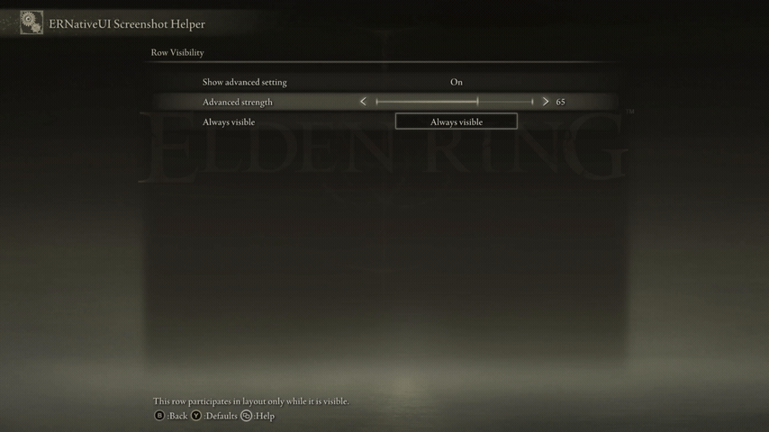

# Show or hide rows at runtime

<table>
  <tr>
    <td align="center" valign="middle">
      <a href="../capabilities.md#what-a-capability-is"></a>
    </td>
    <td valign="middle">
      <a href="../capabilities.md#updates"><code>updates</code></a> ·
      <a href="../capabilities.md#row-visibility"><code>row_visibility</code></a>
    </td>
  </tr>
</table>

If this is your first runtime edit, begin with the
[row-update foundation](README.md). It explains retained typed rows,
`edit()`, optional draft fields, `commit()`, and callback safety.

Use `.visible(bool)` when a row should stop or start participating in the
current layout and pagination:

- `visible(false)` removes the row and closes the layout gap;
- `visible(true)` restores it from its latest logical state; and
- omitting `.visible(...)` from a later edit leaves its current visibility
  unchanged.



*Invisible rows consume no layout slot; the active page and its pagination
rebuild in place.*

## Complete Toggle-controlled example

The example below assumes normal connection setup has already produced:

- `connection`, a valid `erui::Connection` returned by `erui::connect()`; and
- `provider`, the mod's `erui::ProviderOptions`, including its stable provider
  ID, display name, and owner module.

See [Create your first mod](../../getting-started/first-mod.md) for that
process-wide setup. Everything specific to visibility is included here:

```cpp
#include <ernativeui/ERNativeUI.hpp>

namespace {

// Retain the committed registration for later provider operations and retain
// the typed target row for callback-driven edits.
erui::Registration g_registration;
erui::SliderRow g_advanced_strength;

void ERUI_CALL show_advanced_changed(
    void*,
    std::uint8_t value) noexcept
{
    // Toggle callbacks use 0 for Off and 1 for On. Convert that byte to the
    // bool expected by visible(bool).
    const bool show_advanced = value != 0;

    const ERUI_Result result = g_advanced_strength.edit()
        .visible(show_advanced)
        .commit();

    if (result != ERUI_OK) {
        // Log or store result. The previous visibility remains published.
    }
}

bool register_visibility_example(
    const erui::Connection& connection,
    const erui::ProviderOptions& provider) noexcept
{
    if (!connection.supports(erui::Capability::toggle) ||
        !connection.supports(erui::Capability::slider) ||
        !connection.supports(erui::Capability::updates) ||
        !connection.supports(erui::Capability::row_visibility)) {
        return false;
    }

    const auto result = connection.register_menu(
        provider,
        [](erui::Menu& menu) {
            erui::Page page = menu.root();

            page.add_toggle(
                L"Show advanced setting",
                L"Show or hide the dependent strength row.",
                1u, // Initially On, so the target starts visible.
                &show_advanced_changed);

            erui::SliderOptions strength{};
            strength.minimum = 0;
            strength.maximum = 100;
            strength.step = 5;
            strength.initial_value = 65;

            // add_slider returns the typed row used by the callback later.
            g_advanced_strength = page.add_slider(
                L"Advanced strength",
                L"This value is available only while advanced settings show.",
                strength);

            // A logical page may not become empty after a visibility update.
            page.add_toggle(
                L"Always visible",
                L"This stable row keeps the page usable.",
                1u);
        });

    if (!result) {
        // result.error().native_result() and result.error().message()
        // describe the registration failure.
        return false;
    }

    g_registration = result.value();
    return g_advanced_strength.valid();
}

} // namespace
```

`g_advanced_strength` is not a Scaleform pointer. It is a retained
`erui::SliderRow` containing the logical row identity plus the provider/API
context needed by `edit()`. It becomes valid only after `register_menu`
succeeds. `g_registration` is the committed provider handle retained for
other provider-level operations.

The callback may safely call `commit()`. Success means ERNativeUI accepted and
copied the update. Native reconstruction occurs afterward at a UI-safe
boundary, not recursively inside the callback.

## Initial visibility and optional fields

A successfully registered materialized row starts visible. `.visible(...)` is
the only field required for a visibility-only edit; label, help, interaction,
and appearance are not reset when they are omitted.

To start the target hidden, submit one edit only after registration succeeds:

```cpp
const ERUI_Result result = g_advanced_strength.edit()
    .visible(false)
    .commit();

if (result != ERUI_OK) {
    // Handle the rejected initial state.
}
```

Do not submit that edit inside the `register_menu` builder: the provider and
typed row context are not committed until the builder finishes successfully.

## What an invisible row keeps

An invisible row:

- is not materialized in the native page;
- consumes no row or pagination slot;
- cannot receive controller, keyboard, or mouse focus; and
- preserves its host-owned value and every other committed field.

Turning visibility on again reconstructs the row from its current logical
state rather than its original registration snapshot.

## Native rebuild behavior

For an active page, ERNativeUI rebuilds affected native rows in place. It does
not close and reopen the page. The host recomputes:

- visible row order;
- current physical slice;
- Next and Previous navigation rows;
- paginated page titles;
- valid focus; and
- the native subpage scrollbar state.

The row model, pagination, titles, focus, and native subpage scrollbar are
reconciled as one in-place rebuild. That complete lifecycle is live-validated
on Elden Ring executable 2.7.2.0.

If the focused row disappears, focus moves deterministically to a surviving
interactive row. If a TextInput, ColorPicker, Popup Choice, or another native
editor owns menu input, destructive reconstruction is deferred until that
editor closes.

The final projection of one submitted update batch must leave every logical
page with at least one visible row. Keep an always-visible controller or
sentinel when an entire conditional section may disappear.

## Supported rows

API 1.4 supports materialized Button, Toggle, byte Slider, Numeric Slider,
Custom Slider, Inline Choice, Popup Choice, TextInput, and ColorPicker rows.
Submenu is excluded because changing it also affects the native page stack.
Construction-disabled Button and ColorPicker rows are omitted and therefore
cannot become visible later.

Visibility is independent from runtime row availability. If a row must remain
visible but be skipped by focus, use
[runtime row availability](availability.md) instead.

[Row-update foundation](README.md) |
[Runtime row availability](availability.md)
