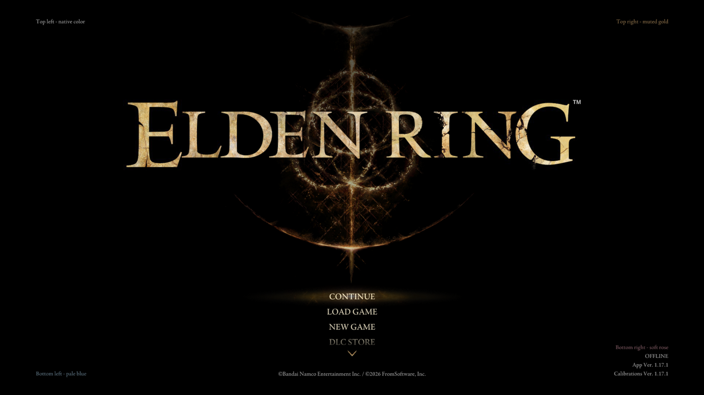

# Title-screen text

API 1.3 lets a client mod add short version, status, or compatibility lines to
any corner of Elden Ring's title screen. Each call adds one immutable line.
ERNativeUI chooses the coordinates from the effective title movie, preserves
native title information, and can use either Elden Ring's native text color or
an explicit RGB color.



*Each registration explicitly selects a corner; a line can inherit Elden
Ring's native color or request an opaque RGB color.*

This guide is for mod authors using the C++17 wrapper. The complete buildable
client is the
[Title-Screen Text example](../../examples/title_screen_text/README.md).

## Find what you need

| Question | Answer |
|---|---|
| How do I add one version or status line? | [Register a line](#register-a-line) |
| Which corners can I use? | [Choose a corner](#choose-a-corner) |
| How do I keep the native color or select my own? | [Choose a color](#choose-a-color) |
| How do I add several lines? | [Add and order multiple lines](#add-and-order-multiple-lines) |
| What capability and registration checks are required? | [Check availability and register](#check-availability-and-register) |
| How do I translate the text? | [Localize player-facing text](#localize-player-facing-text) |
| How long do strings live, and what are the limits? | [Lifetime and limits](#lifetime-and-limits) |
| How does this coexist with DLC text, modified GFX, and other DLLs? | [Layout and compatibility](#layout-and-compatibility) |
| Where is the complete client? | [Buildable example](#buildable-example) |

Use an SDK and host that explicitly expose ERUI API 1.3. Package-release
versions and ERUI API versions are independent; see
[Versioning](../versioning.md).

## Register a line

Add title-screen text inside the same one-time `register_menu` builder used
for settings pages:

```cpp
#include <ernativeui/ERNativeUI.hpp>

void build_menu(erui::Menu& menu) noexcept
{
    if (!menu.supports(erui::Capability::title_screen_text)) return;

    menu.add_title_screen_text(
        erui::TitleScreenCorner::bottom_right,
        {L"My Mod v1.0"});
}
```

The corner is mandatory. There is no default position, and the client does
not supply pixel coordinates. The host copies the text during the call and
places it when completing the title movie.

This API is intended for short information that remains useful while the
player is on the title screen, such as a mod version, active profile, online
mode, or a concise warning. It is not an interactive control and has no
update, callback, animation, or click API.

## Choose a corner

Every call selects one of four values:

```cpp
menu.add_title_screen_text(
    erui::TitleScreenCorner::top_left,
    {L"Top left - native color"});

menu.add_title_screen_text(
    erui::TitleScreenCorner::top_right,
    {L"Top right - muted gold", erui::Color{216U, 167U, 103U}});

menu.add_title_screen_text(
    erui::TitleScreenCorner::bottom_left,
    {L"Bottom left - pale blue", erui::Color{132U, 168U, 192U}});

menu.add_title_screen_text(
    erui::TitleScreenCorner::bottom_right,
    {L"Bottom right - soft rose", erui::Color{190U, 128U, 142U}});
```

Left corners use left-aligned text; right corners use right-aligned text.
Top groups grow down into available space, while bottom groups grow up. The
host keeps them inside the movie's safe stage area and avoids recognized
native or authored title fields.

## Choose a color

Omit the second field to inherit Elden Ring's native title-screen text color:

```cpp
menu.add_title_screen_text(
    erui::TitleScreenCorner::top_left,
    {L"My Mod v1.0"});
```

Supply `erui::Color{red, green, blue}` to request an opaque custom color:

```cpp
menu.add_title_screen_text(
    erui::TitleScreenCorner::top_left,
    {
        L"Experimental build",
        erui::Color{216U, 167U, 103U},
    });
```

Each component is an integer from `0` to `255`. The title-screen API does not
have an alpha component: custom colors are opaque. Omitting `color` is not the
same as approximating the native color with hard-coded RGB values; inheritance
allows a compatible title movie to keep its own authored appearance.

## Add and order multiple lines

Call `add_title_screen_text` once per line. Do not put `\n` in a string:

```cpp
menu.add_title_screen_text(
    erui::TitleScreenCorner::bottom_right,
    {L"My Mod v1.0"});
menu.add_title_screen_text(
    erui::TitleScreenCorner::bottom_right,
    {L"Profile: Challenge Run", erui::Color{216U, 167U, 103U}});
```

Within one corner, lines from the same provider retain their registration
order. Providers form deterministic blocks ordered by ascending
`ProviderOptions::root_priority`, then provider ID, then registration ordinal.
A client should not depend on DLL load timing to determine visual order.

Use separate calls even when the lines belong together. One call containing
a line-break character is rejected.

## Check availability and register

`Capability::title_screen_text` is optional even on a valid API 1.3
connection because the host must first validate the runtime presentation
backend. The capability is also intentionally absent when the player sets
`[GFX] EnableRuntimePatching = 0`: title-screen text requires transforming the
effective title movie. Custom tabs and ordinary client pages can remain
available in that mode, but title lines cannot be inserted into unchanged GFX.
A client must check the capability rather than inspect or modify the player's
host configuration. A client whose only ERNativeUI feature is title text can
check the connection before registering:

```cpp
erui::Registration g_registration{};

const auto connection = erui::connect();
if (!connection) return;
if (!connection.value().supports(
        erui::Capability::title_screen_text)) {
    return;
}

erui::ProviderOptions provider{};
provider.provider_id = "author.my-mod";
provider.display_name = L"My Mod";
provider.owner_module = g_module;

const auto result = connection.value().register_menu(
    provider,
    [](erui::Menu& menu) noexcept {
        menu.add_title_screen_text(
            erui::TitleScreenCorner::bottom_right,
            {L"My Mod v1.0"});
    });

if (result) g_registration = result.value();
```

Here, `g_module` is the client's `HMODULE`, normally saved during
`DLL_PROCESS_ATTACH`. Connect and register from a worker after `DllMain`
returns; do not wait for the host or build a provider while holding the loader
lock. Retain the successful `Registration` for the process lifetime, like any
other committed provider.

If the same provider also publishes settings that remain useful without title
text, keep registering those settings and guard only the optional calls:

```cpp
void build_menu(erui::Menu& menu) noexcept
{
    // Register ordinary pages and rows here.

    if (menu.supports(erui::Capability::title_screen_text)) {
        menu.add_title_screen_text(
            erui::TitleScreenCorner::bottom_right,
            {L"My Mod v1.0"});
    }
}
```

Calling an unavailable feature without the guard fails the provider draft;
it does not publish a partial provider.

## Localize player-facing text

Title-screen lines are ordinary player-facing strings. Choose the translation
before registration with `Connection::game_language()`, using the same
fallback policy as menu titles and row labels:

```cpp
const erui::LanguageInfo language = connection.value().game_language();
const std::wstring line = language.known == erui::GameLanguage::french
    ? L"Mon Mod v1.0"
    : L"My Mod v1.0";

const auto result = connection.value().register_menu(
    provider,
    [line](erui::Menu& menu) noexcept {
        if (menu.supports(erui::Capability::title_screen_text)) {
            menu.add_title_screen_text(
                erui::TitleScreenCorner::bottom_right,
                {line});
        }
    });
```

The host copies `line` before the builder call returns, so the lambda's local
copy does not need process lifetime. Title text is immutable after commit;
changing language or content requires a complete game restart and a new
registration. See [Game language and localization](localization.md) for
known-language, exact-identifier, and fallback handling.

## Lifetime and limits

The API 1.3 contract is deliberately bounded:

- each call adds exactly one non-empty line;
- one line may contain at most 255 valid UTF-16 code units;
- CR, LF, U+0085, U+2028, and U+2029 line separators are rejected;
- all committed ERNativeUI clients share a process-wide limit of 16 lines;
- the host copies text and color during registration; and
- title text cannot be changed after the provider commits.

If one call is invalid or the process-wide limit would be exceeded,
registration fails atomically. No partial provider is published. Keep status
lines concise and do not consume the shared budget with decorative blank
lines.

## Layout and compatibility

Clients choose a corner, not coordinates. ERNativeUI derives bounds,
alignment, line spacing, and collision regions from the effective
`05_000_title.gfx` selected by the game or mod loader.

The bottom-right corner also contains Elden Ring's DLC name, online state,
application version, and calibration version. ERNativeUI preserves those
native fields. With Shadow of the Erdtree installed, its line and authored
gap remain reserved. On the exact validated base-game profile, a known absent
DLC allows custom text to use the otherwise empty placement without the extra
gap. Unknown DLC state and structurally compatible modified movies keep the
space reserved as the conservative fallback. A mod author does not need to
detect DLC ownership or calculate an alternative position.

Structurally compatible modified title movies remain supported. If the
effective movie has an ambiguous or unsupported title hierarchy, ERNativeUI
leaves it unchanged instead of guessing, so registered client lines may be
omitted for that run.

Solid Uncapper compatibility is owned by the host, not by each client. Use
the documented, tested DLL order from
[Game and mod compatibility](../COMPATIBILITY.md#solid-uncapper). Client mods
should not inspect Solid Uncapper, sleep during startup, or delay their own
registration. In the supported combination, ERNativeUI preserves the
validated chain so Solid Uncapper's title information and ERNativeUI provider
text can coexist.

For the presentation boundary and modified-GFX policy, read
[Runtime GFX completion and presentation](presentation-and-gfx.md#title-screen-text).
The implementation evidence behind the structural transformer is recorded in
the [GFX presentation case study](../research/case-studies/gfx-presentation.md).

## Troubleshooting

If a line does not appear:

1. confirm that the client was built with the API 1.3 SDK;
2. confirm `Capability::title_screen_text` before making the call; if it is
   absent, check that the player's `ERNativeUI.ini` has
   `[GFX] EnableRuntimePatching = 1` and fully restart the game;
3. confirm that registration succeeded and its `Registration` was retained;
4. remove other title-text clients temporarily to rule out the 16-line limit;
5. test without a custom `05_000_title.gfx`, then check the modified-GFX
   compatibility rules; and
6. when Solid Uncapper is installed, use the documented DLL order and tested
   versions.

Restart Elden Ring between tests. The title movie and provider topology are
startup state and are not hot-reloaded.

## Buildable example

The focused
[Title-Screen Text example](../../examples/title_screen_text/README.md)
contains the full DLL lifecycle, capability check, provider declaration, four
corner calls, registration retention, CMake target, and Mod Engine 2 load
configuration.

To capture the image reserved near the top of this guide, build and deploy the
[Showcase Screenshot Helper](../../examples/showcase_screenshot_helper/README.md),
set `[showcase] mode=title-screen-text`, and follow its title-screen capture
instructions.
